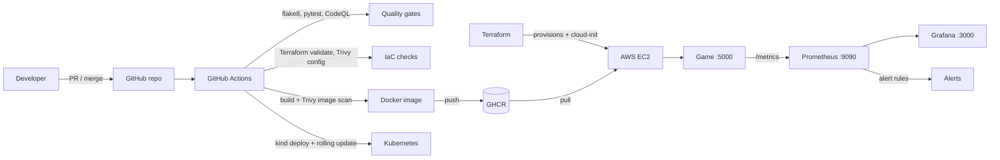

# snake-game

A small Snake game website (Flask) with a global leaderboard, built to demonstrate a complete DevOps
lifecycle: Git workflow, CI/CD, containers, Kubernetes, Terraform on AWS, and Prometheus/Grafana
monitoring with alerting.



## Quick start

```bash
make install && make test
docker compose up -d --build     # game :5000, Prometheus :9090, Grafana :3000 (admin/admin)
```

Open http://localhost:5000 and play. Full build guide: `docs/HOWTO.md`.

## Layout

| Path | Purpose |
|---|---|
| `app/`, `tests/` | Flask game server, static game files, pytest suite |
| `Dockerfile` | Multi-stage, non-root image |
| `.github/workflows/ci-cd.yml` | CI/CD pipeline |
| `k8s/` | Namespace, Deployment, Service, HPA, secret example |
| `terraform/` | AWS EC2 + security group; cloud-init installs Docker and starts the stack |
| `monitoring/` | Prometheus config, alert rules, Grafana dashboard |
| `scripts/git_flow_demo.sh` | Creates a merge conflict for the version-control demo |
